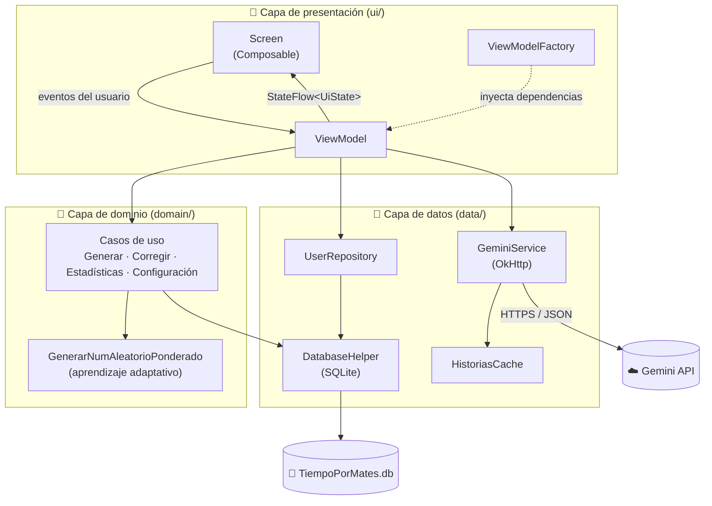
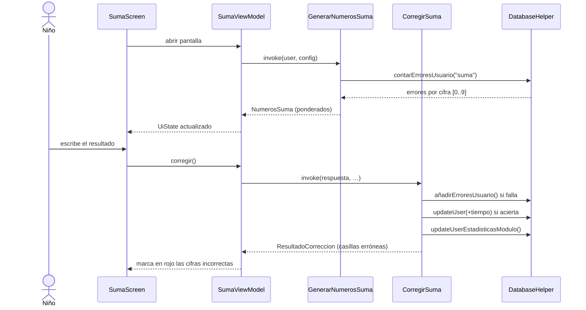
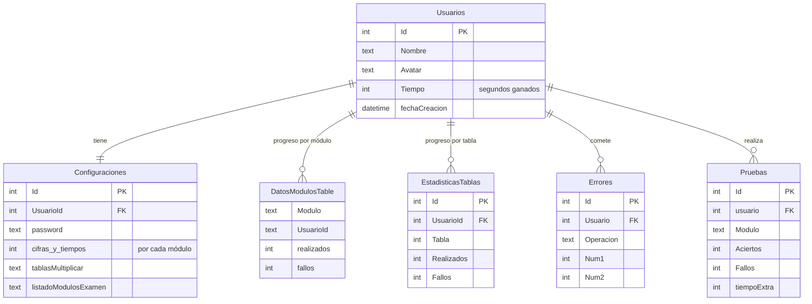

# ⏱️ TiempoPorMates

**Aplicación Android para que niños y niñas practiquen las operaciones básicas de matemáticas y ganen tiempo con cada ejercicio resuelto.**

> 🎓 Proyecto Final del Ciclo Formativo de Grado Superior en **Desarrollo de Aplicaciones Multiplataforma (DAM)**. Calificación: **9**.


---

## 📌 La idea

Muchas familias negocian el tiempo de pantalla o de juego con sus hijos. **TiempoPorMates** convierte ese tiempo en una recompensa: cada operación resuelta correctamente suma segundos a un contador personal. El adulto decide cuánto tiempo vale cada tipo de ejercicio y qué dificultad tiene, y el niño ve cómo su contador crece a medida que practica.

La aplicación, además, **se adapta a cada niño**: registra en qué cifras se equivoca y hace que aparezcan con más frecuencia, para reforzar justo lo que más le cuesta.

## ✨ Funcionalidades

| Módulo | Qué hace |
|---|---|
| ➕ **Sumas** | Sumas de *N* cifras, con o sin llevadas. Corrección cifra a cifra. |
| ➖ **Restas** | Restas de *N* cifras, con o sin llevadas. |
| ✖️ **Multiplicar** | Multiplicaciones con número de cifras configurable en multiplicando y multiplicador. |
| ➗ **Dividir** | Divisiones con cifras configurables en dividendo y divisor; se comprueban cociente y resto. |
| 📋 **Tablas** | Práctica de las tablas de multiplicar que elija el adulto. Estadísticas por tabla. |
| 🧠 **Comprensión** | **Problemas generados con IA (Gemini)**: una pequeña historia en la que el niño debe identificar qué operación resuelve el problema. |
| 📝 **Examen** | Batería de pruebas que mezcla los módulos configurados y se guarda con nota y tiempo. |
| 📊 **Estadísticas** | Porcentaje de acierto por módulo, mejor y peor área, rendimiento por tabla e historial de exámenes. |
| ⚙️ **Configuración** | Protegida por contraseña: dificultad, tiempo ganado por ejercicio, tablas, módulos del examen, reinicio del contador… |

Otras características:

- **Multiusuario** en un mismo dispositivo, cada perfil con su nombre, avatar, configuración y estadísticas.
- **Control parental**: la configuración y el borrado de perfiles requieren contraseña.
- **Funciona sin conexión**: todo se guarda en local; solo el módulo de Comprensión necesita Internet.

---

## 🏛️ Arquitectura

La aplicación sigue el patrón **MVVM (Model–View–ViewModel)** con una **capa de casos de uso** que separa la lógica de negocio de la interfaz, inspirada en los principios de *Clean Architecture*.



### Capas

**1. Presentación — `ui/`**
Cada pantalla vive en su propio paquete con tres piezas:

- `XxxScreen.kt`: interfaz declarativa en **Jetpack Compose** (Material 3). Solo pinta el estado y reenvía eventos al ViewModel.
- `XxxViewModel.kt`: mantiene el estado de la pantalla en un `MutableStateFlow<XxxUiState>` inmutable (data class + `copy`) y lo expone como `StateFlow`. Las operaciones asíncronas se lanzan en `viewModelScope`.
- `XxxViewModelFactory.kt`: construye el ViewModel inyectando el repositorio y los casos de uso que necesita (**inyección de dependencias manual**, sin frameworks).

La navegación se centraliza en `navigation/TiempoPorMatesNav.kt` con **Navigation Compose**, pasando el `userId` como argumento de ruta (`suma/{userId}`, `menu/{userId}`…).

**2. Dominio — `domain/model/usecase/`**
Contiene la lógica de negocio pura, organizada en **casos de uso** con `operator fun invoke(...)`, de forma que se llaman como funciones:

- Generadores de ejercicios: `GenerarNumerosSumaUseCase`, `GenerarNumerosRestaUseCase`, `GenerarNumerosMultiplicacionUseCase`, `GenerarNuevaDivision`, `GenerarOperacionTabla`.
- Correctores: `CorregirSumaUseCase`, `CorregirRestaUseCase`, `CorregirMultiplicacionUseCase`, `CorregirDivisionUseCase`, `CorregirOperacionTablasUseCase`, `corregirComprensionCase`. Además de validar, actualizan las estadísticas, registran los errores y suman el tiempo ganado.
- Gestión: usuarios (`CreateUserCase`, `DeleteUserCase`, `GetAllUsersCase`), configuración (`GuardarConfiguracionUseCase`, `ResetearTiempoUseCase`), exámenes y estadísticas.

**3. Datos — `data/`**

- `Database/DatabaseContract.kt`: esquema de la base de datos (nombres de tablas, columnas y sentencias `CREATE`) separado de la lógica de acceso.
- `Database/DatabaseHelper.kt`: `SQLiteOpenHelper` implementado como **Singleton**, con todas las operaciones CRUD y las consultas de estadísticas.
- `repository/UserRepository.kt`: punto de acceso a los datos de usuario para los ViewModels, con gestión de errores centralizada.
- `Gemini/`: cliente HTTP para la API de Gemini y caché en memoria de historias.
- `entity/`: modelos de datos (`User`, `ConfiguracionUsuario`, `DatosUsuarioModulo`, `Examen`, `Module`…).

### Flujo de un ejercicio



### 🧠 Aprendizaje adaptativo: números aleatorios ponderados

El corazón didáctico de la app es `GenerarNumAleatorioPonderado`. Cada vez que el niño falla, se guarda **qué cifras** estaban implicadas en la tabla `Errores`. Al generar el siguiente ejercicio:

1. Se obtiene el vector de errores del usuario para esa operación (un contador por cifra del 0 al 9).
2. Las cifras con menos errores que la media se compensan sumándoles la media, y los ceros se sustituyen por 1, para que **todas las cifras puedan salir**.
3. Se elige una cifra mediante **selección por ruleta** (probabilidad proporcional a su peso).

Resultado: las cifras que más le cuestan aparecen más a menudo, sin que el ejercicio deje de ser variado. Este algoritmo tiene **tests unitarios** en `app/src/test/.../GenerarNumAleatorioPonderadoTest.kt`.

### 🤖 Integración con IA (módulo Comprensión)

`GeminiServiceImpl` llama al modelo **Gemini 2.5 Flash** con un *prompt* diseñado para un público infantil que exige:

- una historia breve (máx. 100 palabras) con emojis y personajes conocidos;
- **solo verbos asociados a la operación** pedida (p. ej. *repartir, compartir* para la división), para trabajar la comprensión lectora;
- resultados exactos, sin decimales ni negativos;
- respuesta en **JSON estructurado** (`problema`, `respuesta_operacion`) que la app parsea.

Para evitar esperas, el `MenuViewModel` **precarga dos historias en segundo plano** (`HistoriasCache`) en cuanto el usuario entra al menú, de modo que el módulo de Comprensión se abre al instante.

### 🗄️ Modelo de datos (SQLite)



Las tablas dependientes usan `FOREIGN KEY ... ON DELETE CASCADE`, por lo que al borrar un perfil se eliminan todos sus datos, y existen índices sobre las columnas de consulta más frecuentes.

---

## 🛠️ Tecnologías

| Área | Tecnología |
|---|---|
| Lenguaje | Kotlin 2.0 |
| UI | Jetpack Compose · Material 3 |
| Arquitectura | MVVM · casos de uso · Repository · `StateFlow` · Coroutines |
| Navegación | Navigation Compose |
| Persistencia | SQLite (`SQLiteOpenHelper`) |
| Red / IA | OkHttp · `org.json` · Google Gemini API |
| Multimedia | Coil (imágenes y GIF animados) |
| Tests | JUnit |
| Build | Gradle (Kotlin DSL) · Version Catalog (`libs.versions.toml`) · AGP 8.13 |

## 📂 Estructura del proyecto

```
app/src/main/java/com/wezen/tiempopormates/
├── MainActivity.kt                 # Punto de entrada: inicializa la BD y la navegación
├── data/
│   ├── Database/                   # DatabaseContract (esquema) + DatabaseHelper (SQLite)
│   ├── entity/                     # Modelos de datos
│   ├── Gemini/                     # Cliente de la API de Gemini + caché de historias
│   └── repository/                 # UserRepository
├── domain/model/usecase/           # Lógica de negocio (generar, corregir, estadísticas…)
├── ui/theme/
│   ├── Inicio/  Menu/              # Selección de perfil y menú principal
│   ├── Suma/  Resta/  Multiplicar/  Dividir/  Tablas/  Comprension/
│   ├── Examenes/  Estadisticas/  Configuracion/
│   ├── navigation/                 # Grafo de navegación
│   └── theme/                      # Colores, tipografía y componentes reutilizables
└── Util/                           # Utilidades (formato de tiempo)
```

## 🚀 Puesta en marcha

**Requisitos:** Android Studio (Ladybug o superior), JDK 11+, un dispositivo o emulador con Android 7.1 (API 25) o superior.

1. Clona el repositorio:
   ```bash
   git clone https://github.com/RigelChuliaO/TiempoPorMates.git
   ```
2. Consigue una clave de la API de Gemini en [Google AI Studio](https://aistudio.google.com/apikey).
3. Añádela al fichero `local.properties` de la raíz del proyecto (este fichero **no se sube al repositorio**):
   ```properties
   GEMINI_API_KEY=tu_clave_aqui
   ```
4. Abre el proyecto en Android Studio, sincroniza Gradle y ejecuta la configuración `app`.

> La contraseña inicial de cada perfil es `1234`. La app avisa al crearlo para que se cambie desde Configuración.

## 🧪 Tests

```bash
./gradlew test
```

## 🗺️ Próximos pasos

- [ ] Publicación en Google Play (programa *Diseñado para familias*).
- [ ] Mover las llamadas a Gemini a un backend propio o a Firebase AI Logic con App Check.
- [ ] Migraciones de base de datos que conserven el progreso entre versiones.
- [ ] Aplicar la ponderación por errores también a Tablas y División.
- [ ] Ampliar la cobertura de tests a los casos de uso de corrección.

---

## 👤 Autor

**Rigel Chuliá Ortega** · [GitHub](https://github.com/RigelChuliaO)

Proyecto desarrollado como Trabajo de Fin de Grado del CFGS **Desarrollo de Aplicaciones Multiplataforma**, calificado con un **9**.
